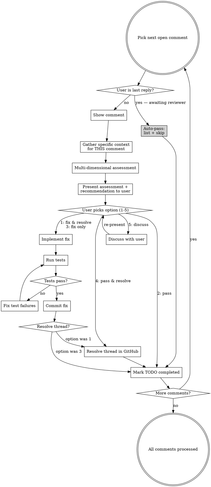

# PR Review Process Comments

## Overview

Interactive, user-controlled workflow for processing GitHub PR review comments. Every action requires explicit user approval. The agent critically evaluates each comment against project context before proposing action; the user decides.

**Preflight:** run `bash "${CLAUDE_PLUGIN_ROOT}/scripts/preflight.sh"` as the first
action. A non-zero exit stops the skill: print its output verbatim and do nothing else.

**Core principle:** You are an advocate for the codebase and the user's intent, not an obedient follower of reviewer requests. A reviewer requesting a change is NOT sufficient justification for making the change.

**Announce at start:** "Using pr-review:process-comments to process PR feedback interactively."

**GitHub:** every call goes through the github plugin's `mcp__github__gh` tool, as GitHub calls below describes; the Bash route is for sessions where that tool is not listed.

## Iron Rules

| Rule | Meaning |
| --- | --- |
| **No code changes without approval** | Propose fixes, wait for user to say "fix". Never edit code proactively. |
| **No self-replies to comments** | Propose response text, show it to user. Never post it yourself. |
| **No auto-resolve** | Only resolve when user explicitly picks option 1 (fix & resolve) or 4 (pass & resolve). Never resolve on your own. |
| **Separate commits** | Each "fix" gets its own commit. Never batch multiple fixes. |
| **Clean commit messages** | Short, conventional commit prefix (`fix:`, `refactor:`, `style:`, etc.). No mention of: TODO list, Claude, PR comments, review conversations. |
| **Every comment addressed** | No comment may be left without an explicit choice (option 1-4) from the user. |
| **Never push commits** | NEVER run `git push`. The user will push commits themselves. |
| **No agreement without evidence** | NEVER assess a comment as "pertinent" without citing specific evidence from project context. "Reviewer says so" and "it's a best practice" are NOT evidence. |

### Critical Assessment Rules

**A reviewer requesting a change is necessary but NOT sufficient.** Every change request must be evaluated against:

1. Project norms and standards (CLAUDE.md, CONTRIBUTING.md)
2. Codebase patterns (how do similar files handle this?)
3. Feature purpose and intent (PR description, ticket)
4. Code quality impact (does the change actually improve things?)
5. Scope appropriateness (is this change in scope for this PR?)

**"Best practice" does NOT override project practice.** If the project has an established pattern, the reviewer's preference for a different pattern is NOT a valid reason to change this one file. Consistency with the existing codebase matters more than abstract ideals.

**When in doubt, recommend AGAINST the change.** The burden of proof is on the change, not on the status quo. If you cannot find concrete evidence that the change improves the codebase, recommend against it and explain your reasoning to the user.

**"Pending evidence" means disagree.** If you cannot gather evidence to support a change (e.g., cannot confirm codebase patterns), that is NOT a hedge — it is a reason to recommend against. Do not qualify your disagreement as "pending evidence" and then flip to agreement if the reviewer pushes back. Absence of evidence supporting a change = evidence against making it.

### Red Flags - STOP Immediately

If you catch yourself thinking any of these, STOP:

- "This fix is obvious, I'll just do it" → **NO. Propose it. Wait for "fix".**
- "I'll reply to explain the rationale" → **NO. Propose the reply. Show it to the user.**
- "The comment is addressed, I'll resolve it" → **NO. Only resolve if user chose option 1 or 4.**
- "These two comments are related, one commit is fine" → **NO. One commit per fix.**
- "I should reference the PR comment in the commit" → **NO. Clean commit messages with conventional prefix only.**
- "I don't need a prefix for this commit" → **NO. Every commit uses a conventional prefix (`fix:`, `refactor:`, `style:`, etc.).**
- "This comment isn't important, I'll skip it" → **NO. Show it. User picks from options 1-5.**
- "I'll push the commits now" → **NO. NEVER push. The user will do it.**
- "The reviewer is right, this is a known best practice" → **NO. Check if the PROJECT uses this practice. Best practices don't override project patterns.**
- "The reviewer is senior, they probably know better" → **NO. Seniority is not evidence. Evaluate the suggestion on its merits against project context.**
- "The reviewer likely knows the API" / "reviewer has domain knowledge" / "reviewer knows the protocol" → **NO. ALL forms of "reviewer knows X" are assumptions. Search the codebase. If you can't verify, ask the user.**
- "The reviewer says property X exists, so it must" → **NO. Search for X in the codebase. If you can't find it, mark ⚠️ and ask the user where to verify.**
- "I marked ⚠️ but the change is still reasonable" → **NO. ⚠️ = fail. Any ⚠️ means you CANNOT recommend Agree. Period.**
- "If the API always returns X..." → **NO. Conditionals ("if...") are uncertainty. Uncertainty = ⚠️ = fail. You need evidence, not hypotheticals.**
- "The user already replied but I should still assess it" → **NO. User is last reply = auto-pass. No assessment, no options. Skip immediately.**
- "This issue comment is resolved but the content is interesting" → **NO. Resolved = skip. The batch check said "resolved". Do not process it.**
- "The reviewer asked a question, but I think they want a change" → **NO. A question is a question. Answer it. Do not propose code changes unless the answer reveals an actual bug.**
- "I found an inconsistency while investigating, I should fix it" → **NO. The reviewer didn't ask for a fix. Answer their question. If you think something needs fixing, mention it as a separate observation — do not bundle it into the assessment as "Agree".**
- "It can't hurt to make this change" → **NO. Every unnecessary change adds noise to the diff, risks regressions, and obscures the feature's intent.**
- "The reviewer will be annoyed if I push back" → **NO. Your job is to advocate for the codebase, not to avoid social friction.**
- "I said 'pending evidence' so I should defer" → **NO. Pending evidence means disagree. Absence of supporting evidence = recommend against.**
- "The reviewer explained their reasoning, so it must be valid" → **NO. A well-articulated argument is not the same as project-specific evidence. Evaluate the EVIDENCE, not the eloquence.**

---

## Workflow

### GitHub calls

Every GitHub call below is written as the request the github plugin's
`mcp__github__gh` tool takes: one JSON object holding `command` and `args`. Make
it as a call of that tool, the placeholders filled in: `"<PR>"` and every other
number (`line`, `start-line`, `review-id`) as a JSON number, text as a string. A
body travels as `body` and a set of inline comments as `comments`, never as a
file path: the tool writes them to files itself.

A write made through the tool passes the session's permission check. Where this
plugin's module loads, it also holds this skill's Iron Rules (no code change
without option 1 or 3, no resolve without option 1 or 4, no reply posted, no
push): ask the user for that word first.
A forced push and a deleted comment stay refused.

**When `mcp__github__gh` is not in your tool list** (a session where plugin
modules do not load, such as `claude -p`), read `references/bash-route.md` and
send the same request to the same engine from Bash. Never take that route while
the tool is listed.

### Step 0: Triage — one call

Call the `mcp__pr-review__open_comments` tool, with no input for the current branch's pull request, or `{"pr": <number>}`
when the user named one. It reads the PR, its issue comments, its reviews and its
open threads through `mcp__github__gh`, drops what is resolved or minimized on
GitHub, and answers one JSON document.

**When `mcp__pr-review__open_comments` is not in your tool list**, run the same
triage from Bash, as `references/bash-route.md` « Triage » says.

The document:

| Field | Meaning |
| --- | --- |
| `pr`, `title`, `url`, `description` | the PR and its intent (Step 0.5 reads the intent here) |
| `author` | the PR author's login: a thread whose last reply is theirs is awaiting the reviewer |
| `pending`, `tier`, `counts` | the workload: open threads not auto-passed, issue comments, review bodies; `EXIT`, `FAST` or `FULL` |
| `announce` | the line Step 1 says first, word for word |
| `paths` | the files that carry an open thread |
| `items` | one per open comment: `type` (`review-thread`, `issue-comment`, `review-body`), `id`, `node_id` (issue comments), `path` and `line` (threads), `author`, `body`, `images` (issue comments), `auto_passed`, `last_reply` (auto-passed threads), `state` (review bodies) |

`"pr": null` with an `error` means the branch has no open pull request: tell the
user and stop.

Keep the scratch directory `/tmp/claude-pr-review-<pr>` for anything this skill
writes to disk (downloaded images); the PR number in its name keeps two runs on two
PRs apart.

### Step 1: Triage — Announce the Workload FIRST (MANDATORY)

**Before building any context, tell the user how much work there is.** The user must never wait through the full setup without knowing it.

Immediately output the document's `announce` line, before any further tool call:

> **PR #N — X open comment(s):** Y review thread(s), Z issue comment(s), W review body comment(s).

**Then take the protocol tier from `tier` (it follows X). This is not optional — the protocol scales to the workload:**

| Open comments | Tier | Skip | Do |
| --- | --- | --- | --- |
| **0** | **Exit** | Everything — no context, no TODO list, no tables | Say "No open review comments found on this PR." and **stop immediately** |
| **1–2** | **Fast** | Step 2 TODO list entirely; the summary tables; the `paths` pre-read | Read only the commented file(s), then go straight to Step 3 per comment |
| **3+** | **Full** | Nothing | Read `references/full-tier.md` now: Step 0.5 context build + Step 2 TODO list + full protocol |

**Fast tier is the common case.** Most PRs have 1–2 open comments. Building a TaskCreate list, printing summary tables, and pre-reading every commented file for a single comment is pure ceremony — it burns the user's tokens and their patience for zero benefit. The `TaskCreate` tool's own documentation says not to use it for a single trivial task; that guidance wins over Step 2 here.

**Red flags at this step:**

- "I'll build the TODO list anyway, it's more rigorous" → **NO. 1–2 comments = no TODO list. The tier table is binding.**
- "I already know there's only one comment, but the skill says Step 0.5 is MANDATORY" → **NO. Step 0.5 is mandatory in Full tier only. Fast tier reads the commented file and moves on.**
- "I'll finish the setup first, then tell the user the count" → **NO. Announce the count BEFORE any further tool call.**
- "The count is low but the comment looks complex, so Full tier" → **NO. Tier depends on comment COUNT, not perceived difficulty. Per-comment depth comes from Step 3.2, which is unchanged.**

### Steps 0.5 and 2 (Full tier only — 3+ comments)

In Full tier, read `references/full-tier.md` and follow it before the first comment: it builds the project context (Step 0.5) and the TODO list (Step 2). Fast tier skips both: read the commented file(s) directly and go to Step 3.

### Step 3: Process Each Comment



For **each** open comment, follow this exact sequence:

**Process review threads first, then review body comments, then issue comments. Skip auto-passed items.**

#### 3.0 Auto-Pass Check (MANDATORY FIRST STEP)

**Before doing ANYTHING else for this comment**, check: is the user the last person to reply?

Resolved issue comments are already filtered out by the Step 0 triage — they never appear in the TODO list. This check is only for review threads where the user replied last (awaiting reviewer).

For review threads: the item's `auto_passed` is true when the last reply is the PR author's — this thread is **awaiting the reviewer's response**:

```markdown
## Comment N/total — @author [review-thread] ⏭️ AUTO-PASSED

**File:** `path/to/file.ext:line`
**Reason:** You already replied — awaiting reviewer's response.
**Your reply:** > "<the item's last_reply, truncated to 80 chars>"

_Skipping — no assessment needed._
```

**If user is last reply → mark TODO as completed, move to next comment. Do NOT gather context, do NOT assess, do NOT present options. No exceptions.**

#### 3.1 Show the Comment

Display the full comment with context:

**For review threads:**

```markdown
## Comment N/total — @author [review-thread]

**File:** `path/to/file.ext:line`
**Thread ID:** `PRRT_xxxxx`

### Reviewer's comment

> <full comment text>

### Code in question

\`\`\`<lang>
<3-7 lines of code around the commented line, with the specific line highlighted>
\`\`\`
```

**For issue comments:**

```markdown
## Comment N/total — @author [issue-comment]

**Comment ID:** `123456789`
**Location:** PR conversation (not code-linked)

### Reviewer's comment

> <full comment text>

### Attached images

<For each of the item's images: download with curl -sL -H "Authorization: Bearer $GH_TOKEN" to "/tmp/claude-pr-review-<PR number>/img_N.png" — the scratch directory from Step 0, spelled out — then Read to display>
```

**Images are important context.** If the reviewer attached screenshots/diagrams, display them — they often show bugs or expected behavior that text alone doesn't convey.

**For review body comments:**

```markdown
## Comment N/total — @author [review-body]

**Review ID:** `PRR_xxxxx`
**Review state:** COMMENTED / CHANGES_REQUESTED / APPROVED
**Location:** Review comment (not code-linked)

### Reviewer's comment

> <full comment text>
```

#### 3.1b Classify Comment Intent (BEFORE assessment)

**Before gathering context or assessing, determine what the reviewer is actually asking:**

| Intent | Signals | Action |
| --- | --- | --- |
| **Question** | Ends with `?`, asks "right?", "is it?", "do we?", "why?", "what happens?" | Answer the question. Do NOT propose code changes unless the answer reveals a bug. |
| **Change request** | "Should be X", "Missing Y", "Add Z", imperative verbs | Assess with full 6-dimension critical analysis. |
| **Bug report** | "I have this error", screenshots of broken UI, "it doesn't work" | Investigate the bug. Propose a fix only if you can reproduce/understand it. |
| **Confirmation** | "X, right?", "Do we have Y?" with no imperative | Confirm or deny. No code change needed. |

**A question is NOT a change request.** "Do we have `+3s`, right?" is asking for confirmation that the value represents +3 seconds — it is NOT asking you to reformat the display. Do NOT invent a code change when the reviewer is simply asking a question.

**When in doubt, classify as question.** A wrong change is worse than a missing change. If the comment is ambiguous, present your interpretation to the user and ask: "I read this as a question, not a change request. Do you agree?"

#### 3.2 Gather Context for This Comment (MANDATORY)

Use the context already gathered (Full tier: Step 0.5 pre-read everything; Fast tier: you read the commented file when you reached it). Only do NEW searches if the reviewer raises a concern not covered by what you already read.

**Tier does NOT change per-comment rigor.** Fast tier skips the TODO list and the bulk pre-fetch — it does not skip evidence gathering. Every comment still gets the full 6-dimension assessment in Step 3.3, with codebase patterns verified by Grep.

1. **Check codebase patterns:** If the reviewer suggests a different approach, search the codebase for how other files handle this SAME concern. Use Grep to find 2-3 examples. **Skip if the pre-read files already answer the question.**
2. **Check project norms:** Reference the CLAUDE.md/CONTRIBUTING.md already read in Step 0.5.
3. **Check feature intent:** Reference the document's `description`, fetched in Step 0.
4. **Verify reviewer claims:** If the reviewer claims properties, fields, types, or behaviors exist — **SEARCH the codebase to verify.** If you cannot find them, you CANNOT mark Technical accuracy as ✅. Ask the user: "I can't find [X] in the codebase. Where can I verify this?"

**You must have evidence before you can assess.** If you skip this step, your assessment is uninformed and likely deferential.

**"Reviewer knows the domain/protocol/API" is NEVER a substitute for searching the codebase.** You have Grep and Glob — use them. If the reviewer says property X exists, search for it. If you can't find it, ask the user. Never mark ✅ based on what the reviewer "probably knows."

#### 3.3 Critical Assessment

Evaluate the comment through **all 6 dimensions**. The comment must pass ALL to be recommended:

| Dimension | Question | Fail = |
| --- | --- | --- |
| **Technical accuracy** | Is the reviewer's claim factually correct? | Disagree — reviewer misunderstands the code |
| **Project norm alignment** | Does the change align with CLAUDE.md/CONTRIBUTING.md? | Disagree — contradicts project standards |
| **Codebase consistency** | Do similar files in the project follow the reviewer's suggested pattern? | Disagree — breaks established patterns |
| **Feature purpose** | Does the change serve the feature's stated intent? | Disagree — undermines what the PR is trying to do |
| **Code quality** | Does the change make the code concretely better (not just different)? | Disagree — change is lateral, not an improvement |
| **Scope** | Is this change in scope for this PR? | Partially agree — valid but belongs in separate PR |

**Verdict semantics — these are NOT flexible:**

| Verdict | Meaning | Effect on recommendation |
| --- | --- | --- |
| ✅ | Dimension clearly passes with concrete evidence | Counts as pass |
| ⚠️ | Doubt, uncertainty, or conditional ("if the API...") | **Counts as FAIL — cannot recommend Agree** |
| ❌ | Dimension clearly fails | Counts as fail |

**Mapping verdicts to recommendation — MANDATORY:**

| Verdict pattern | Recommendation |
| --- | --- |
| All 6 are ✅ | Agree |
| Any ⚠️ or ❌ present | **Partially agree or Disagree** — NEVER Agree |
| Any ❌ on Technical accuracy or Code quality | **Disagree** |

**⚠️ means you have DOUBT — and doubt means recommend AGAINST.** If you write ⚠️, you are admitting you lack evidence to pass the dimension. "Agree" requires 6 ✅ with cited evidence. No exceptions.

**Evidence rules:**

- ✅ requires citing a **specific file, line, norm, or pattern** in the project. No exceptions. All of the following are NOT evidence and CANNOT produce ✅:
  - "Reviewer likely knows" / "reviewer has domain knowledge" / "reviewer knows the protocol"
  - "No relevant norm" (neutral fact, not a pass)
  - "The function already handles X" (describes current code, not evidence FOR the change)
  - "This adds valuable info" (your opinion, not project evidence)
- ⚠️ is the verdict when you have a conditional ("if the API..."), an assumption ("reviewer probably knows"), an unverified claim ("property X exists"), or no concrete evidence either way. **When the reviewer claims properties/fields/types exist that you haven't verified in the codebase → ⚠️, not ✅.**
- ❌ is the verdict when you have concrete evidence AGAINST.

**Present the assessment in this format:**

```markdown
### Critical Assessment

| Dimension | Verdict | Evidence |
| --- | --- | --- |
| Technical accuracy | ✅/⚠️/❌ | <specific evidence> |
| Project norms | ✅/⚠️/❌ | <specific evidence from CLAUDE.md/CONTRIBUTING.md, or "no relevant norm"> |
| Codebase consistency | ✅/⚠️/❌ | <specific evidence — cite files checked and patterns found> |
| Feature purpose | ✅/⚠️/❌ | <specific evidence from PR description/ticket> |
| Code quality | ✅/⚠️/❌ | <concrete improvement identified, or "lateral change — not an improvement"> |
| Scope | ✅/⚠️/❌ | <in scope or "valid but separate PR"> |

### Recommendation: <Agree / Partially agree / Disagree>

**Summary:** <2-3 sentences explaining the overall recommendation and the key deciding factor>
```

Then present either a proposed fix (if recommending agreement) or a suggested response (if recommending disagreement), following the format below:

**If recommending agreement (all dimensions pass):**

```markdown
### Proposed Fix

**Before:**
\`\`\`<lang>
<current code>
\`\`\`

**After:**
\`\`\`<lang>
<proposed code>
\`\`\`

**What this fix does:** <1-2 sentences explaining the approach and tradeoffs>
```

**If recommending partial agreement:**

```markdown
### Proposed Partial Fix

**What to accept:** <specific part of reviewer's suggestion that passes all dimensions>
**What to decline:** <specific part that fails one or more dimensions, with reason>

**Before:**
\`\`\`<lang>
<current code>
\`\`\`

**After:**
\`\`\`<lang>
<proposed code implementing only the accepted part>
\`\`\`
```

**If recommending disagreement:**

```markdown
### Recommendation: Disagree

**Key reason:** <the primary dimension that failed, with evidence>

### Suggested response for reviewer

> <polite but substantive response explaining WHY the change shouldn't be made, citing specific project context>

**DO NOT post this response yourself** — only show it to the user.
```

#### 3.4 Present Options

After the assessment and proposal, always present the action selector:

```markdown
---

> **1. Fix & resolve** — Apply the fix, run tests, commit, and resolve the thread
> **2. Pass** — Skip this comment, no changes, no resolution
> **3. Fix only** — Apply the fix, run tests, commit, but keep the thread open
> **4. Pass & resolve** — No code change, but resolve the thread
> **5. Discuss** — Ask questions or suggest a different approach
>
> Reply with **1**, **2**, **3**, **4**, or **5**
```

Wait for user response. Do NOT proceed without explicit user input.

#### 3.5 Handle User Choice

Accepted inputs (case-insensitive):

| Input | Aliases | Action |
| --- | --- | --- |
| **1** or **fix & resolve** | "fix resolve", "fr", "fix and resolve" | → Apply fix + resolve thread |
| **2** or **pass** | "p", "skip", "no", "next" | → Skip entirely |
| **3** or **fix only** | "fix", "f", "fix no resolve" | → Apply fix, keep thread open |
| **4** or **pass & resolve** | "pr", "resolve only", "just resolve" | → No code change, resolve thread |
| **5** or **discuss** | "d", "why", "?", "let's discuss" | → Open discussion |

Any other input → Treat as discussion (option 5).


Then, by the option chosen:

- **5 (discuss):** read `references/discuss.md`.
- **1 (fix & resolve) or 3 (fix only):** read `references/fix.md`.
- **2 (pass):** mark TODO completed and move to the next comment. No code change, no commit, no resolution.
- **4 (pass & resolve):** resolve the comment as `references/resolve.md` says, then mark TODO completed and move to the next comment. No code change, no commit.

When every comment is processed, read `references/completion.md` for the summary.

---

## Error Handling

| Error | Solution |
| --- | --- |
| `No GitHub token` | Run `/pr-review:install` to sign in to GitHub |
| `No git remote origin` | Ensure you're in a git repository |
| PR not found / empty PR_NUM | Ensure you're on a branch with an open PR |
| `API rate limit exceeded` | Wait for reset |

Resolution errors are in `references/resolve.md`; a failing test after a fix in `references/fix.md`.

## Rationalization Table

The Red Flags above hold every other excuse.

| Excuse | Reality |
| --- | --- |
| "I'll batch the push at the end" | Commits are separate. Push is at the end. That's fine. |
| "I don't have time to check codebase patterns" | Context gathering takes 30 seconds. Bad assessments waste far more time. |
| "I'll agree now and the user can override" | Your assessment should be honest. Agreeing by default wastes the user's decision budget. |
| "This is just a style preference, might as well" | Style preferences without project norm backing are NOT pertinent. Consistency > personal preference. |
| "The comment makes a good general point" | General points that don't apply to THIS project context are not pertinent. Specificity matters. |
| "I'll agree now and hedge with 'partially'" | Partial agreement must be earned dimension by dimension. Don't use it as a diplomatic compromise. |
| "The inconsistency I found justifies a change" | Does the REVIEWER want this change? If they asked a question, the answer might be "yes, that's correct — no change needed." |
